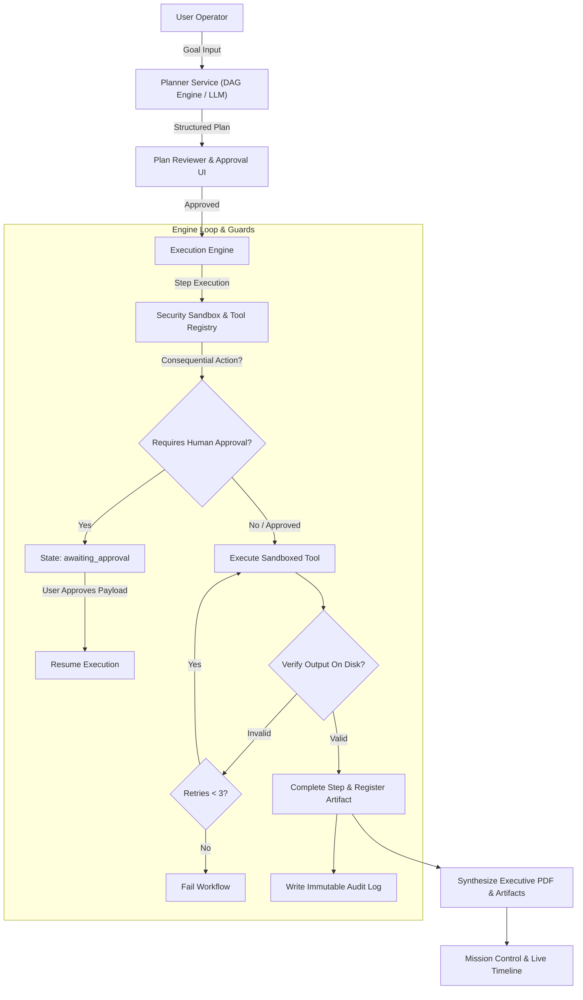

# AutoPilot AI — Intelligent Workflow Automation Platform

**AutoPilot AI** is a production-oriented workflow automation platform that converts natural-language goals into structured, dependency-aware task plans (DAGs), executes them through sandboxed tools, enforces human-in-the-loop approvals for consequential actions, verifies every output empirically, and produces executive reports with downloadable artifacts.

---

## 🌟 Key Capabilities

1. **Natural-Language Task Planner**:
   - Accepts complex user goals (e.g., *"Analyze sales records in CSV, generate visual breakdown charts, benchmark against current market trends, and produce an executive PDF report."*).
   - Generates deterministic, dependency-ordered DAG task plans.
   - Allows users to review, edit, approve, or reject steps and toggles before execution.
   - Built-in heuristic planner works **out of the box with zero external API keys required**, with optional plug-and-play support for Google Gemini and OpenAI GPT-4o.

2. **Agent Execution Engine**:
   - Multi-state workflow engine: `pending`, `running`, `awaiting_approval`, `completed`, `failed`, `cancelled`, and `skipped`.
   - Sequential and dependency-aware topological execution.
   - Bounded retries (up to 3x) and execution timeouts with graceful recovery.
   - **Empirical Output Verification**: Verifies schema integrity, non-zero file sizes, and valid disk artifacts before marking any step as completed.

3. **Secure Sandboxed Tool Layer**:
   - **CSV / Excel Analytics**: Reads datasets, computes column distributions, statistics, and missing value checks.
   - **Visual Chart Generator**: Renders high-resolution bar/line/pie charts and persists PNG artifacts.
   - **Document Summarizer & File Reader**: Extracts executive summaries and highlights.
   - **Web Research Adapter**: Connects to Tavily/SerpAPI when keys exist, or runs safe, clearly labeled mock knowledge research.
   - **Report Generator**: Generates verifiable Markdown documents and professional PDF reports via ReportLab.
   - **Email Drafter & Dispatcher**: Consequential tool strictly guarded behind human approval.
   - **REST API Gateway**: Domain allowlisted HTTP integration gateway.

4. **Human Approval & Security Sandbox**:
   - **Human-in-the-Loop Gate**: Consequential actions (e.g. sending emails, external mutations) pause execution and prompt the operator with an interactive review modal displaying the exact payload.
   - **Filesystem Sandbox**: All file reading and writing is restricted to `./backend/workspace/`. Path traversal attacks (`../`) are blocked with `PermissionError`.
   - **Prompt Injection Defense**: Sanitizes adversarial instructions (`Ignore previous instructions`, `system override`) in retrieved content.
   - **Immutable Audit Logging**: Records every plan generation, tool execution, human approval decision, and error event with timestamps.

---

## 🏗️ Architecture



---

## 🚀 Quickstart & Local Setup

### Prerequisites
- **Python 3.10+**
- **Node.js 18+** and **npm**

### 1. Backend Setup
```bash
cd backend

# Install dependencies
pip install -r requirements.txt

# Initialize database, tools registry, and seed demonstration datasets
python seed_data.py

# Launch FastAPI development server
uvicorn app.main:app --reload --host 127.0.0.1 --port 8000
```
- The backend API will be live at `http://127.0.0.1:8000`.
- Interactive Swagger documentation: `http://127.0.0.1:8000/docs`.

### 2. Frontend Setup
```bash
cd frontend

# Install Node packages
npm install

# Launch Vite development server
npm run dev
```
- Open your browser at `http://localhost:5173`.

### 3. Quick 1-Click Login Personas
No manual registration required! You can click either demo button on the login screen:
- **Admin Director**: `admin@autopilot.ai` / `admin123`
- **Data Analyst**: `analyst@autopilot.ai` / `analyst123`

---

## 🐳 Docker Deployment

To launch the full stack in isolated containers:
```bash
# Build and run backend + frontend containers
docker-compose up --build
```
- Frontend: `http://localhost:5173`
- Backend API: `http://localhost:8000/docs`

---

## 🧪 Running Automated Tests

Run the complete test suite verifying DAG planning, tool execution, human approval enforcement, and sandbox containment:
```bash
cd backend
python -m pytest tests/ -v
```

All 9 test suites validate:
- Valid sequential DAG dependency resolution
- Blocking unapproved consequential actions
- Successful execution and receipt generation when approved
- Path traversal confinement within `/backend/workspace`
- Prompt injection redaction and sanitization
- Empirical output verification on disk

---

## 📋 Demonstration Walkthrough Script

### Demo 1: Sales CSV Analytics & Executive PDF Generation (Autonomous Flow)
1. Log in using the **Admin Director** demo persona.
2. Click **New Workflow** in the sidebar.
3. Click the preset: *"Analyze sales records in CSV, generate visual breakdown charts, benchmark against current market trends, and produce an executive PDF report."*
4. Click **Synthesize Plan**. Observe how the planner generates a 4-step DAG pipeline:
   - Step 1: `analyze_csv` on `sample_datasets/sales_q3.csv`
   - Step 2: `generate_chart` plotting `region` vs `revenue`
   - Step 3: `web_research` benchmarking enterprise growth trends
   - Step 4: `generate_report` compiling analytical findings into Markdown & PDF.
5. Click **Approve Plan & Launch Execution**.
6. Watch the live timeline execute each task in real time.
7. Once completed, inspect the generated PNG chart, preview the Markdown report in the browser, or click **Download** to inspect the real generated PDF!

### Demo 2: Customer Sentiment & Email Alert (Human-in-the-Loop Gated Flow)
1. Navigate to **New Workflow** and select the third preset:
   *"Analyze customer feedback CSV, plot rating distributions, compile summary findings, and prepare an alert email for management sign-off."*
2. Notice the lock icon indicating that the consequential email step requires **Human Approval**.
3. Click **Approve Plan & Launch Execution**.
4. The workflow will execute steps 1 to 3 automatically, then transition to `awaiting_approval` and pause!
5. Notice the **Review & Authorize** callout banner.
6. Open the approval modal, review the exact email recipient, subject line, and draft body.
7. Click **Approve & Resume Execution**.
8. The engine immediately resumes, transmits the email with an authenticated receipt ID, and finalizes the run.
9. Visit the **Execution & Audit** tab to inspect the immutable audit log entry of your authorization decision.
