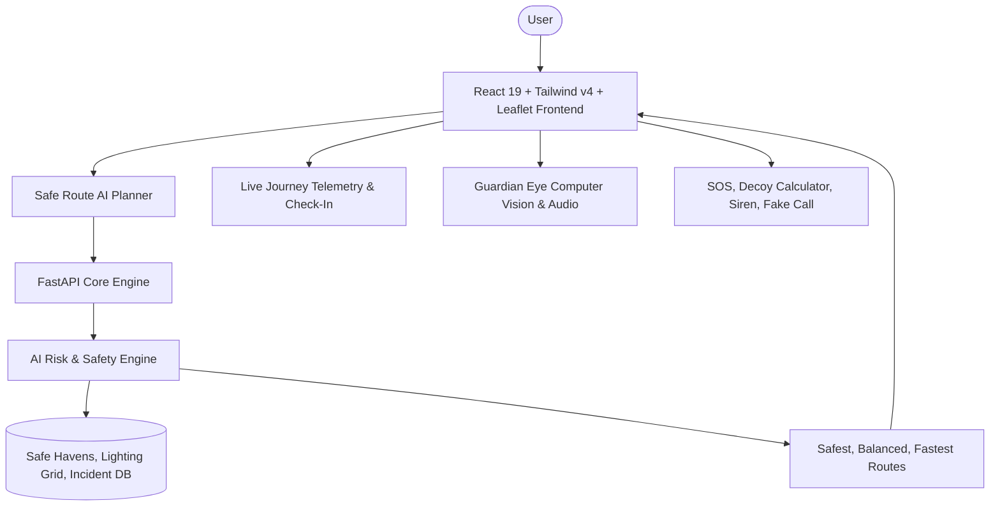

# HERGUARD AI 🛡️
### AI-Powered Women’s Safety, Risk Prediction & Emergency Response Platform

[](https://opensource.org/licenses/MIT)
[](https://fastapi.tiangolo.com/)
[](https://react.dev/)
[](https://tailwindcss.com/)
[](https://leafletjs.com/)

> **“How risky is this journey, what safer alternatives exist, and what should happen if something goes wrong?”**

HERGUARD AI is an intelligent safety ecosystem engineered to protect women **before, during, and after** every journey. Rather than relying solely on reactive panic buttons when danger has already escalated, HERGUARD AI provides proactive predictive risk modeling, multi-factor safe routing, continuous satellite journey tracking, 3-stage autonomous check-ins, on-device computer vision sentinel monitoring, and stealth emergency response tools.

---

## 🌟 Key Features

### 1. 🎯 AI Safety Score Engine (0–100)
* Computes probabilistic risk estimations across six weighted environmental & historical factors:
  * **Street Lighting (Lux Index)**: Verified lumens and illumination grid.
  * **Pedestrian / Commercial Activity**: Density of foot traffic and open storefronts.
  * **Emergency Proximity**: Density of police kiosks, women helpline booths, and 24/7 hospitals.
  * **Historical Incident Penalty**: Spatial deductions based on verified community hazard reports.
  * **Isolation Factor**: Geometric connectivity and absence of dead-ends.
  * **Transit Proximity**: Distance to operational metro concourses and bus stops.
* *Transparent labeling*: Predictions are clearly designated as **probabilistic risk estimates**, empowering informed user decisions without false guarantees.

### 2. 🗺️ Safe Route AI & Comparative Analysis
* Generates three distinct route paths for any origin and destination:
  * **Safest Route (Route A)**: Maximizes lighting, maintains line-of-sight with verified 24/7 safe havens, and avoids reported incident hotspots.
  * **Balanced Route (Route B)**: Optimal compromise between transit duration and safety score.
  * **Fastest Route (Route C)**: Direct transit path, highlighting dark shortcuts or unmonitored alleys to avoid.
* **Explainable AI Justifications**: Plain-language explanations detailing why one path is safer than alternatives.
* **Side-by-Side Comparison Matrix**: Real-time evaluation of Time, Distance, Safety Score, and Risk Tier.

### 3. 🌙 NightWalk Mode
* One-touch night protocol activating heightened safety thresholds after dark:
  * Lighting factor weight increased from **20% to 35%**.
  * Isolation penalties amplified by **30%**.
  * Automatic rerouting toward continuous LED-lit arterial avenues.
  * Displays real-time estimated safety improvement deltas (e.g., `+18 Safety Points`).

### 4. 🛰️ Safe Journey Mode & Anomaly Telemetry
* Continuous journey monitoring with real-time GPS simulation and ETA calculation.
* **Autonomous Anomaly Detection**:
  * **Route Deviation Detector**: Triggers warning if location wanders > 100m off course.
  * **Unexpected Stop Detector**: Triggers warning if movement halts in isolated zones for an extended duration.

### 5. ⏱️ 3-Stage Smart Check-In Protocol
* Configurable check-in frequencies (5 min, 15 min, 30 min, plus 10-second fast demonstration mode):
  * **Stage 1 (Gentle Ping)**: Soft audio reminder asking *"Are you doing okay?"*.
  * **Stage 2 (Verification Warning)**: Audible prompt and 30-second countdown asking *"Do you need help?"*.
  * **Stage 3 (Autonomous Escalation)**: Immediate dispatch of emergency alerts with live GPS coordinates to trusted contacts and emergency desks.

### 6. 🚨 Stealth Emergency Response Suite
* **Instant SOS**: 5-second cancel buffer to prevent false alarms, followed by broadcast dispatch.
* **Discreet Decoy Mode (Calculator)**: Disguises the screen as a functional calculator to prevent hostile observation; exits via secret PIN (`1357=`).
* **Deterrent Siren**: High-frequency acoustic deterrent synthesized directly via Web Audio API.
* **Fake Incoming Call Simulator**: Realistic incoming smartphone call screen with simulated conversational audio to facilitate safe departures.

### 7. 👁️ Guardian Eye: AI Computer Vision Sentinel
* Client-side neural gesture and audio analysis via browser camera and microphone.
* Distress gesture recognition (hands raised / panic motion).
* Acoustic distress and scream volume detection (dB spikes).
* **100% On-Device & Private**: No video or audio telemetry leaves the local device.

### 8. 📍 Interactive Safety Heatmap & Safe Haven Directory
* Dynamic map layers:
  * 🟢 Low-risk zones
  * 🟡 Moderate-risk corridors
  * 🔴 Elevated-risk areas
  * Verified Safe Havens: 24/7 Police Outposts, Hospitals, 24/7 Pharmacies, Partner Hubs.

---

## 🏗️ Architecture



---

## 🚀 Quick Start Guide

### Prerequisites
* **Node.js** (v18+)
* **Python** (v3.10+)

### 1. Start Backend Server
```bash
cd backend
python -m uvicorn app.main:app --reload --port 8000
```
Backend API interactive documentation will be accessible at `http://127.0.0.1:8000/docs`.

### 2. Start Frontend Application
```bash
cd frontend
npm install
npm run dev
```
Open `http://localhost:5173` in your browser.

*(Note: The frontend includes full offline fallback support and functions seamlessly out-of-the-box even before launching the backend).*

---

## 🧪 Automated Testing

Run the safety scoring engine test suite:
```bash
python backend/tests/run_tests.py
```
Or using pytest:
```bash
pytest backend/tests/
```

To verify the frontend production build:
```bash
cd frontend
npm run build
```

---

## 📂 Project Structure

```
herguard-ai/
├── backend/
│   ├── app/
│   │   ├── api/              # FastAPI endpoints (routes, incidents, safe-havens, sos)
│   │   ├── data/             # Geospatial datasets (safe havens, lighting lux, incidents)
│   │   ├── engine/           # AI Multi-factor Safety & Risk calculation engine
│   │   ├── models/           # Pydantic schemas
│   │   └── main.py           # FastAPI entrypoint with CORS
│   ├── tests/                # Automated unit tests
│   └── requirements.txt
├── frontend/
│   ├── src/
│   │   ├── components/
│   │   │   ├── common/       # Navigation Header, NightWalk toggle
│   │   │   ├── map/          # Leaflet SafetyMap with heatmaps & safe havens
│   │   │   ├── routing/      # Safe Route selector, comparison table
│   │   │   ├── journey/      # Real-time journey telemetry monitor
│   │   │   ├── checkin/      # 3-Stage Smart Check-In modal
│   │   │   ├── emergency/    # SOS countdown, Decoy calculator, Siren, Fake call
│   │   │   ├── sentinel/     # Guardian Eye computer vision & audio sentinel
│   │   │   ├── incidents/    # Crowdsourced incident reporting & upvoting
│   │   │   ├── analytics/    # Safety analytics & time-of-day risk charts
│   │   │   └── contacts/     # Trusted circle & live tracking link generator
│   │   ├── services/         # API client with offline resilience
│   │   └── App.jsx           # Main orchestrator
│   └── package.json
└── README.md
```

---

## ⚖️ License
Distributed under the MIT License. Built with empathy and precision for women's personal safety.
