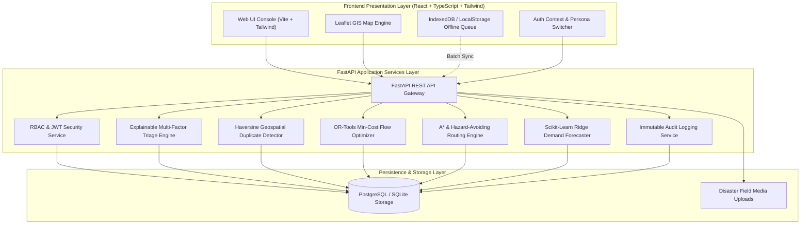
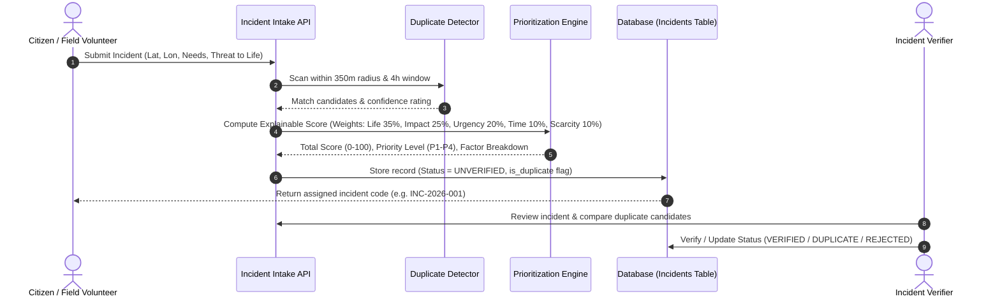

# ResQNet — Architecture & System Design Documentation

## 1. System Overview
**ResQNet** is an Intelligent Disaster Response and Resource Coordination Platform designed strictly as a **decision-support tool** for authorized human responders during flood, earthquake, storm, and civil emergencies.

ResQNet centralizes emergency requests, manages supply depot inventories, solves multi-commodity bipartite allocation problems, predicts localized supply demand using machine learning, routes around hazardous bridges and roads, and coordinates shelters and volunteer teams.

---

## 2. High-Level Architecture Diagram

---

## 3. Core Modules & Data Flow

### A. Incident Intake, Deduplication & Triage Workflow

---

## 4. Mathematical Optimization Formulation (Resource Allocation)

The resource allocation module solves a **Multi-Commodity Min-Cost Network Flow / Linear Programming Problem** using Google OR-Tools.

### Mathematical Formulation:
- Let $D = \{d_1, d_2, \dots, d_m\}$ be the set of active resource depots.
- Let $J = \{j_1, j_2, \dots, j_n\}$ be the set of verified emergency incidents.
- Let $K$ be the set of resource commodities (Drinking Water, Food Packets, First-Aid Kits, Medicines, Rescue Gear, Vehicles, Tents).
- Let $S_{ik} \ge 0$ denote the available quantity of resource $k$ at depot $i$.
- Let $R_{jk} \ge 0$ denote the requested demand of resource $k$ at incident $j$.
- Let $x_{ijk} \ge 0$ be the decision variable representing the units of resource $k$ transported from depot $i$ to incident $j$.
- Let $u_{jk} \ge 0$ be the unmet demand variable for resource $k$ at incident $j$.
- Let $c_{ij}$ be the geospatial distance (km) between depot $i$ and incident $j$.
- Let $P_j \in [0, 100]$ be the triage priority score of incident $j$.

$$\min \sum_{k \in K} \left( \sum_{i \in D} \sum_{j \in J} (c_{ij} - \alpha P_j) x_{ijk} + \sum_{j \in J} (M + \beta P_j) u_{jk} \right)$$

### Subject to:
1. **Depot Capacity Constraint:**
   $$\sum_{j \in J} x_{ijk} \le S_{ik}, \quad \forall i \in D, \forall k \in K$$
2. **Incident Demand Conservation:**
   $$\sum_{i \in D} x_{ijk} + u_{jk} = R_{jk}, \quad \forall j \in J, \forall k \in K$$
3. **Non-negativity:**
   $$x_{ijk} \ge 0, \quad u_{jk} \ge 0, \quad \forall i, j, k$$

Where $M$ is a heavy shortage penalty ($500.0$) and $\alpha, \beta$ are priority scaling multipliers ensuring high-priority incidents are supplied first while minimizing total transit distance.

---

## 5. Machine Learning Forecasting Architecture

- **Algorithm:** Ridge Linear Regression ($L_2$ regularization) fitted on multi-variable disaster demand vectors:
  $$X = [\text{Population\_k}, \text{Elapsed\_Hours}, \text{Incident\_Count}, \text{Severity\_Index}]$$
- **Confidence Bounds:**
  $$\text{CI}_{95\%} = \hat{y} \pm 1.96 \times \sigma_{\text{residual}}$$
- **Shortage Flagging:**
  $$\text{Shortage}_k = \max(0, \hat{y}_k - \text{Depot\_Stock}_k)$$

---

## 6. Role-Based Access Control (RBAC) Matrix

| Module / Action | Community Reporter | Volunteer SAR | Resource Manager | Incident Verifier | Emergency Coordinator | Administrator |
|---|---|---|---|---|---|---|
| Report Incident | Yes | Yes | Yes | Yes | Yes | Yes |
| View Operations Map | Yes | Yes | Yes | Yes | Yes | Yes |
| View Protected Contacts | Redacted | Redacted | Yes | Yes | Yes | Yes |
| Verify / Triage Incidents | No | No | No | Yes | Yes | Yes |
| Restock Depots | No | No | Yes | No | No | Yes |
| Run OR-Tools Optimizer | No | No | Yes | No | Yes | Yes |
| Update Shelter Occupancy | No | Yes | No | No | Yes | Yes |
| Deploy Volunteers | No | No | No | No | Yes | Yes |
| Edit Triage Weights | No | No | No | No | No | Yes |
| View System Audit Logs | No | No | No | No | Yes | Yes |
